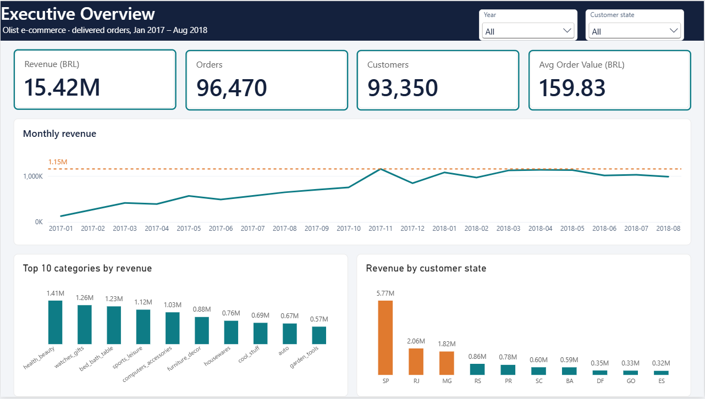
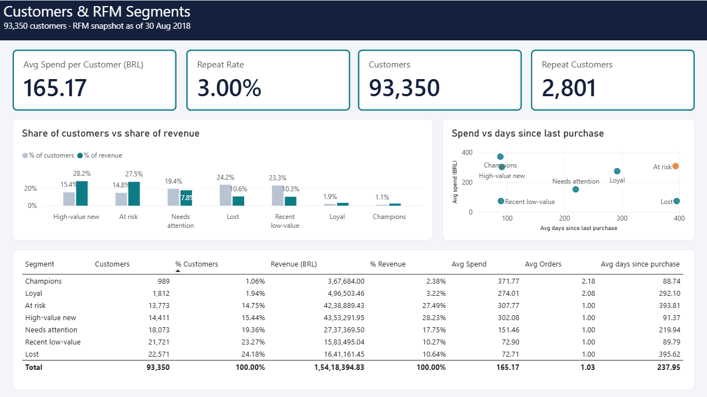
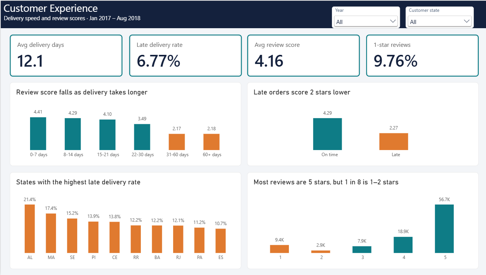
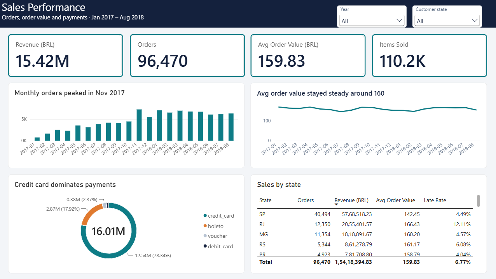
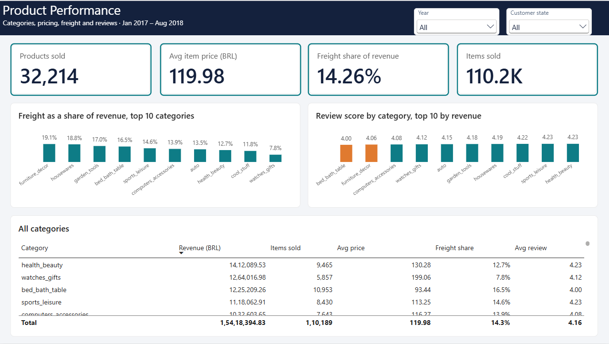

# Olist E-Commerce Customer Intelligence

End-to-end customer intelligence analysis of the Olist Brazilian e-commerce dataset using Python, SQL, RFM segmentation, Power BI and machine learning.

**Status:** Complete

## Business Questions
- How are revenue and orders changing over time?
- Which products and categories drive sales?
- Which customers are most valuable, and which are at risk?
- How does delivery performance relate to customer reviews?
- Can we spot late orders and likely repeat buyers early, and what do unhappy customers complain about?

## Key Findings
- Monthly orders grew from 750 (Jan 2017) to a peak of 7,288 (Nov 2017), then levelled off at around 6,000-7,000 a month.
- Only 3.0% of customers placed more than one order, so retention is the biggest growth opportunity.
- SP, RJ and MG generate 62.5% of revenue; the top 10 categories generate 62.4%.
- Late orders average 2.27 stars versus 4.29 for on-time orders, and 52.5% of late orders get a 1-star review.
- Two one-time buyer segments, High-value new and At risk, are 30.2% of customers but 55.7% of revenue.
- Customers whose first order was late came back 3.02% of the time, compared with 4.05% after an on-time first order.
- The biggest complaint in negative reviews is missing or wrong items (32.6%), followed by delivery delays (21.4%).

## Machine Learning

| Notebook | Question | Result |
|---|---|---|
| `5_Late_Delivery_Prediction` | Can we tell at purchase time that an order will be late? | Logistic regression ROC AUC 0.690. The riskiest 10% of orders were late 10.34% of the time vs 4.40% overall, and contained 23.5% of all late orders. |
| `6_Repeat_Purchase_Prediction` | Does the first order predict a second purchase? | Random forest ROC AUC 0.611. The top 10% of customers by score repeated at 7.06% vs 3.98% overall (lift 1.78). |
| `7_Review_Text_Analysis` | What do unhappy customers write about? | Text model ROC AUC 0.972. Five complaint themes found; delivery themes cover 48.4% of negative reviews and missing or wrong items 32.6%. |

How the models were built:
- Late delivery uses only information known when the order is placed. Delivery dates and review scores are left out so the model can't see the answer.
- The late delivery model is trained on orders before May 2018 and tested on later orders.
- Late orders and repeat buyers are rare, so models use balanced class weights and are judged on ROC AUC, PR AUC and top-10% results, not accuracy.
- The prediction models are modest. They work best for ranking orders and customers by risk, not as yes/no answers.

## Dataset
[Olist Brazilian E-Commerce Public Dataset](https://www.kaggle.com/datasets/olistbr/brazilian-ecommerce) — 9 relational tables covering orders, customers, products, sellers, payments, reviews and geolocation.

Data files are not included in this repository.

## Tools
Python (pandas, matplotlib, scikit-learn), MySQL, SQLAlchemy, Power BI (DAX, Power Query)

## Power BI Dashboard
- 5 pages: Executive Overview, Customers & RFM Segments, Customer Experience, Sales Performance and Product Performance.
- Star schema with `Orders` at the centre, linked to Customers, RFM_Customers and a Date table, with Order_Items, Payments and Reviews at their own grain.
- 25 DAX measures. All revenue and customer measures use the same `in_analysis_scope` rule as the Python and SQL analysis.
- Core measures validated against Python and SQL: revenue 15,418,394.83 BRL, 96,470 orders, 93,350 customers.

## Dashboard Preview

### Page 1 — Executive Overview



Olist brought in **15.42M BRL** from **96,470 delivered orders** and **93,350 customers**, with an average order value of **159.83 BRL**. Monthly revenue climbed through 2017, peaked in **Nov 2017** (Black Friday) and then held steady through 2018. **health_beauty** (1.41M), **watches_gifts** (1.26M) and **bed_bath_table** (1.23M) are the top categories, and **SP alone brings in 5.77M BRL**, followed by RJ (2.06M) and MG (1.82M).

### Page 2 — Customers & RFM Segments



Only **2,801 of 93,350 customers (3.00%)** bought more than once, and the average customer spent **165.17 BRL**. Customers are split into 7 RFM segments. Two one-time buyer segments stand out: **High-value new** (15.4% of customers, 28.2% of revenue) are recent big spenders and the best target for a second purchase, while **At risk** (14.8% of customers, 27.5% of revenue) spent just as much but have not bought in over a year. **Champions** and **Loyal** customers spend the most per person but make up only 3% of customers.

### Page 3 — Customer Experience



Orders take **12.1 days** on average, **6.77%** arrive late, and **9.76%** of reviews are 1-star. Review scores stay above 4 for deliveries up to 21 days (4.41, 4.29, 4.10), drop to 3.49 at 22–30 days, and fall to about **2.2 for anything over 30 days**. Late orders score **2.27** on average against **4.29** for on-time orders, a gap of 2 stars.

### Page 4 — Sales Performance



Monthly orders peaked in **Nov 2017**, while the average order value stayed steady at around **160 BRL** the whole time, so growth came from more orders, not bigger ones. **Credit card** makes up **78.3%** of payment value, followed by boleto (17.9%). The state table shows that delivery problems are uneven: **SP** has a 4.49% late rate, while **RJ**, the second-largest market, is at **12.11%**, and **AL** is the worst at **21.41%**.

### Page 5 — Product Performance



**32,214 products** were sold across **110,189 items**, at an average item price of **119.98 BRL**, and freight makes up **14.26%** of revenue. Bulky categories cost the most to ship: **furniture_decor (19.1%)** and **bed_bath_table (16.5%)** have among the highest freight shares in the top 10, and they also have the **lowest review scores (4.06 and 4.00)**. watches_gifts has the lowest freight share at 7.8%.

## Insights and Recommendations
See [Insights_and_Recommendations.md](Insights_and_Recommendations.md) for the full findings and business recommendations.

## How to Reproduce
1. Download the CSVs from Kaggle into `Data/Raw/`.
2. Run `Notebooks/1_Data_Understanding.ipynb` to review the data.
3. Run `Notebooks/2_Data Cleaning & Preprocessing.ipynb` to create the cleaned tables in `Data/Processed/`.
4. In MySQL, run the files in `SQL/` in this order:
   - `1_Create_Database.sql` (as root, set your own password for `olist_user`)
   - `2_Database_setup.sql`
   - `4_load_to_MYSQL.py` (loads the cleaned CSVs and checks totals against pandas)
   - `3_Sales_Analysis.sql`
5. Run `Notebooks/3_EDA.ipynb` for the exploratory analysis.
6. Run `Notebooks/4_RFM.ipynb` for customer segmentation. This also creates `rfm_customers.csv` in `Data/Processed/`.
7. Open `E_Dashboard.pbix` in Power BI Desktop and click **Refresh** to load the processed data.
8. Run the three ML notebooks from the `Notebooks` folder:
   ```
   jupyter nbconvert --to notebook --execute --inplace 5_Late_Delivery_Prediction.ipynb 6_Repeat_Purchase_Prediction.ipynb 7_Review_Text_Analysis.ipynb
   ```
   This also creates `late_risk_predictions.csv` and `repeat_purchase_scores.csv` in `Data/Processed/`.

## Progress
- ✅ Data understanding
- ✅ Data cleaning
- ✅ SQL analysis
- ✅ Exploratory data analysis
- ✅ RFM segmentation
- ✅ Power BI dashboard
- ✅ Insights and recommendations
- ✅ Machine learning (late delivery, repeat purchase, review text)

---

## Feedback

If you found this project useful or interesting, feel free to give the repository a **star** on GitHub.

I'm also open to **feedback, suggestions, and ideas for improvement**.

## Author

**Shoumik Chakravarty**

B.Tech Computer Science & Engineering

Interested in **Data Analytics, Data Science, Machine Learning, and Business Intelligence**.

This project was created as part of my data analytics portfolio to demonstrate practical experience across the full analytics workflow: **data cleaning, SQL, exploratory analysis, customer segmentation, Power BI dashboard development, machine learning, and business-oriented storytelling**.
